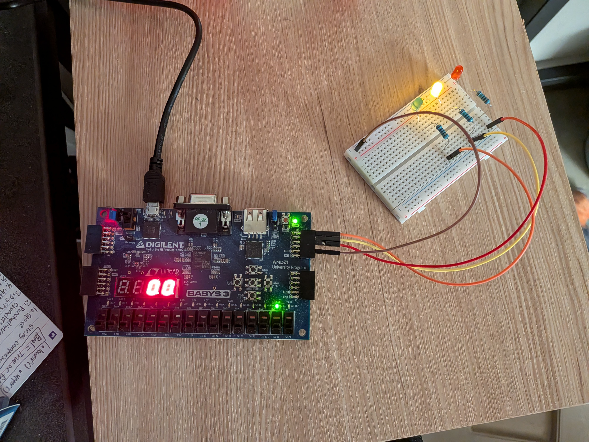
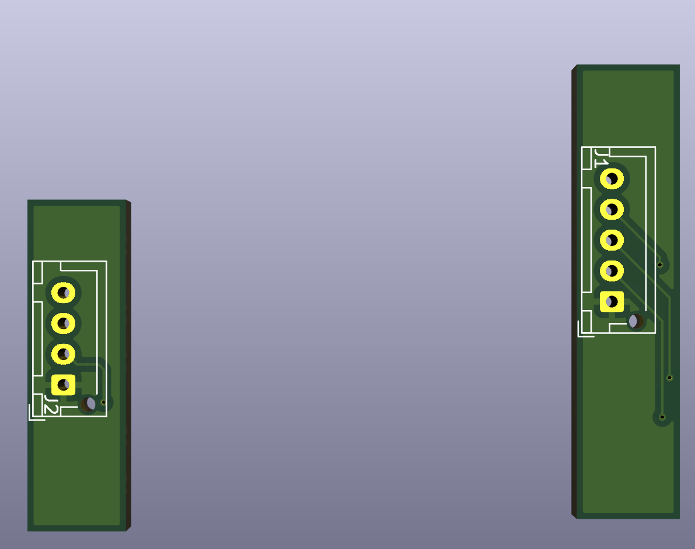
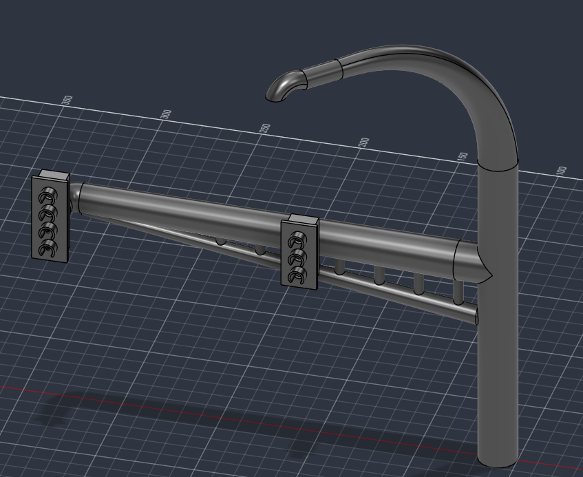

# Basic-Traffic-Light-Controller

In this project, I will be working on creating a basic traffic light and progressing as I learn more about Verilog through college. I will be using a Basys 3 FPGA Board to program it. My goal with this project is to develop my skills in Verilog and Electrical Engineering, with the eventual goal of turning this into a complete intersection.

Throughout this project, I plan to continue adding to it, starting with the basics and working my way up to a fully functioning intersection by adding the following:

- Pedestrian Crossing Timer ✅
- Traffic Light Switch Controls ✅
- Traffic Light Intersection
- Add Left Turn Signals
- UART Debugging
- Add VGA Interface
- Add Sensors

Things I hope to add once I have learned and become proficient in them through college:

- Soft Processor Interface
- RISC-V Integration
- Make an ASIC Style Design

---

## Implemented Features

### 1. Traffic Light Controller

Implemented a Finite State Machine (FSM) that cycles through three traffic light states:

| State | LED Output | Duration |
|-------|------------|----------|
| Green | LED 2 | 20 seconds |
| Yellow | LED 1 | 3 seconds |
| Red | LED 0 | 10 seconds |

- Duration can be easily changed by adjusting the parameters within [traffic_light.v](./traffic_light.v#L60-L62).

The controller continuously follows the sequence:

`GREEN → YELLOW → RED → GREEN`

A center pushbutton (`btnC`) resets the controller to the Green state.

.

### 2. Clock Divider

Implemented a clock divider that converts the Basys 3's 100 MHz system clock into a one-second timing pulse.

- Counts 100,000,000 clock cycles.
- Generates a one-clock-cycle tick signal every second.
- Uses the timing pulse to control FSM transitions.
- Provides timing for the flashing indicators.

### 3. Pedestrian Timer

#### Countdown Timer

Added countdown functionality to calculate the remaining time in the current traffic light state.

The countdown automatically updates once per second.

#### Two-Digit Seven-Segment Display

Expanded the original single-digit display to support two-digit countdown values.

Implemented:

- Tens and ones digit conversion.
- Decimal division and modulus operations.
- Seven-segment number decoding.
- Display selection using the Basys 3 anode outputs.

The countdown is separated into individual digits using:

- Tens = Countdown / 10
- Ones = Countdown % 10

### 4. Seven-Segment Display Multiplexing

Implemented display multiplexing to operate two seven-segment digits using shared segment outputs.

A refresh counter rapidly alternates between the two active digits.

- Uses `refresh_counter` to control display timing.
- Uses `digit_select` to alternate between the tens and ones digits.
- Uses `display_value` to select the number sent to the seven-segment decoder.
- Uses AN1 and AN0 for the two-digit display.

### 5. Flashing Warning Indicator

Added a flashing zero indicator during the Yellow and Red traffic light states. This acts as a wait indication for pedestrians.

- The display alternates between showing zero and being blank.
- A separate `blink` signal controls the flashing.
- The `blink` signal toggles once per second.

### 6. PCB Design

To transition this project from relying solely on the Basys 3's onboard LEDs to a physical prototype, a custom Printed Circuit Board (PCB) was designed using KiCad.

#### PCB Features:

- **Custom LED Array:** Houses the required Red, Yellow, and Green LEDs to simulate the through-traffic light outputs. A secondary PCB houses the LEDs (Red, Yellow, Green, and Flashing Yellow LEDs) to simulate left-turn traffic light outputs.
- **Current Limiting:** Includes onboard resistors (e.g., 100-ohm) to safely drive the LEDs directly from the FPGA's 3.3V logic.
- **FPGA Interface:** Utilizes JST connector headers (J1 and J2) to cleanly wire the board directly to the Basys 3 PMOD expansion ports.
- **Physical Integration:** Designed with specific dimensions and routing clearances to fit into the custom 3D-modeled housings.

### 7. CADD Model

A complete 3D mechanical model of the traffic light intersection was designed to house the electronics and bring the project to life.

#### Model Features:

- **Mast Arm Assembly:** Features a realistic main vertical pole, a curved upper mast arm, and a lower horizontal support structure.
- **Modular Light Housings:** Includes two distinct, structurally integrated enclosures:
  - **Straight Light:** A standard three-light housing equipped with visors for the primary Green/Yellow/Red sequence.
  - **Left Turn (LT) Light:** A four-light housing designed to support the planned addition of dedicated left-turn signals.
- **Hardware Integration:** The housings are dimensioned to securely mount the custom PCB, allowing for internal wire routing through the support arms and down the main pole to the Basys 3 board.

### 8. Traffic Light Switch Controls

Added three switch-controlled functions using switches SW0, SW1, and SW2 on the Basys 3 FPGA board.

#### Flashing Red Mode — SW0

When SW0 is activated:

- The Red traffic light LED (LED 0) flashes once per second.
- The external Red LED connected to JB3 also flashes.
- The normal traffic-light sequence is paused.
- The seven-segment display alternates between showing zero and being blank.

#### Flashing Yellow Mode — SW1

When SW1 is activated:

- The Yellow traffic light LED (LED 1) flashes once per second.
- The external Yellow LED connected to JB2 also flashes.
- The normal traffic-light sequence is paused.
- The seven-segment display alternates between showing zero and being blank.

#### Switch Priority

When both SW0 and SW1 are activated at the same time, Flashing Red takes priority over Flashing Yellow.

#### Green Extension — SW2

Added a Green Extension function to simulate a vehicle detection system.

- When SW2 is activated during the Green state, the Green countdown pauses.
- The Green traffic light remains active while the countdown is paused.
- When SW2 is deactivated, the countdown resumes from its previous value.
- SW2 does not affect the Yellow or Red states.

#### Automatic Reset After Flashing Modes

Added flashing-mode transition detection using a `flashing_previous` register to identify when either flashing mode was previously active.

When both flashing switches are turned off after a flashing mode:

- The controller automatically resets to Green.
- The elapsed time counter resets to zero.
- The Green countdown restarts at its full 20-second duration.
- Normal traffic-light operation resumes.

This ensures that the controller restarts in a predictable state after either manual flashing mode is deactivated, rather than resuming an interrupted traffic-light sequence.

