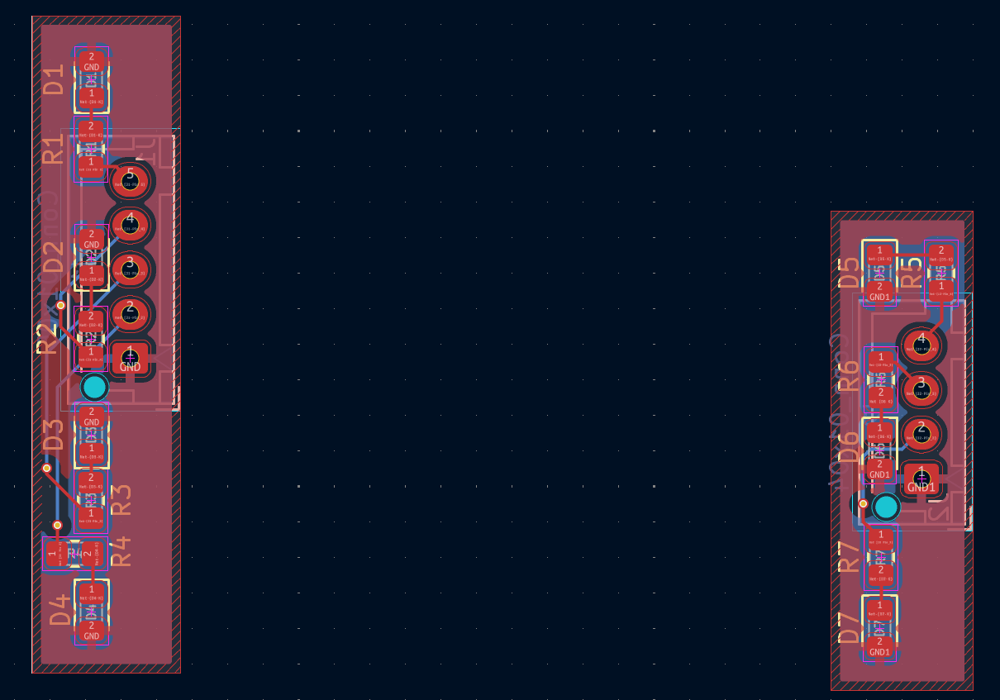
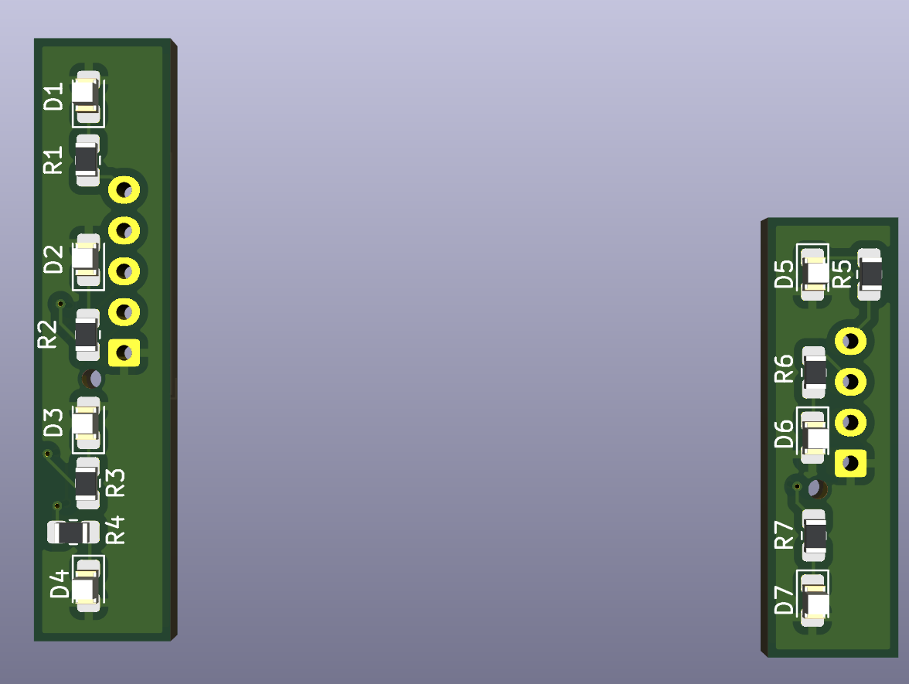

# Basic-Traffic-Light-Controller
In this Project I will be working on creating a basic traffic light and progress as I learn more with Verilog through college. I will be using a Basys 3 FPGA Board to program it. My goal with this project is to progress my skills in Verilog and Electrical Engineering with the goal of eventually making this into a complete intersection.

Throughout this project I plan to continue adding too this project, starting with the basics and working my way up to a full functioning intersection by adding the following:

- Pedestrian Crossing Timer ✅
- Emergency Service Setting
- Traffic Light Intersection
- Add Left Turn Signals
- UART Debugging
- Add VGA Interface
- Add Sensors
    
Things I hope to add once I have learned and proficient in through college:
- Soft Processor Interface
- RISC-V Integration
- Make an ASIC Style Design

## Implemented Features

### 1. Traffic Light Controller

Implemented a Finite State Machine (FSM) that cycles through three traffic light states:

| State | LED Output | Duration |
|-------|------------|----------|
| Green | LED 0      | 20 seconds |
| Yellow | LED 1      | 3 seconds |
| Red | LED 2      | 10 seconds |

The controller continuously follows the sequence:

GREEN → YELLOW → RED → GREEN

A center pushbutton (btnC) resets the controller to the Green state.

### 2. Clock Divider

Implemented a clock divider that converts the Basys 3's 100 MHz system clock into a one-second timing pulse.

- Counts 100,000,000 clock cycles.

- Generates a one-clock-cycle tick signal every second.

- Uses the timing pulse to control FSM transitions.

- Provides timing for the flashing warning indicator.

### 3. Pedestrian Timer

#### Countdown Timer

Added countdown functionality to calculate the remaining time in the current traffic light state.

The countdown automatically updates once per second.

#### Two-Digit Seven-Segment Display

Expanded the original single-digit display to support two-digit countdown values.

Implemented:

- Tens and ones digit conversion.

- Decimal division and modulus operations.

- Seven-segment number decoding.

- Display selection using the Basys 3 anode outputs.

The countdown is separated into individual digits using:

- Tens = Countdown / 10

- Ones = Countdown % 10

### 4. Seven-Segment Display Multiplexing

Implemented display multiplexing to operate two seven-segment digits using shared segment outputs.

A refresh counter rapidly alternates between the two active digits.

- Uses refresh_counter to control display timing.

- Uses digit_select to alternate between the tens and ones digits.

- Uses display_value to select the number sent to the seven-segment decoder.

- Uses AN1 and AN0 for the two-digit display.

6. Flashing Warning Indicator

Added a flashing zero indicator during the Yellow and Red traffic light states. (Acts as a wait sign for pedestrians)

- The display alternates between showing zero and being blank.

- A separate blink signal controls the flashing.

- The blink signal toggles once per second.

### PCB Design

To transition this project from relying solely on the Basys 3's onboard LEDs to a physical prototype, a custom Printed Circuit Board (PCB) was designed using KiCad. 
Eventually, the led outputs will transfer to using the PMOD GPIO pins built into the Basys 3

#### PCB Features:
* **Custom LED Array:** Houses the required Red, Yellow, and Green LEDs to simulate the thru traffic light outputs, a secondary PCB houses the LEDS (Red, Yellow, Green, and Flashing Yellow LEDS simulate left turn traffic light outputs.
* **Current Limiting:** Includes onboard resistors (e.g., 100-ohm) to safely drive the LEDs directly from the FPGA's 3.3V logic.
* **FPGA Interface:** Utilizes a JST connector header (J1 & J2) to cleanly wire the board directly to the Basys 3 PMOD expansion ports.
* **Physical Integration:** Designed with specific dimensions and routing clearances to slot seamlessly into the custom 3D-modeled housings.

### CADD Model

A complete 3D mechanical model of the traffic light intersection was designed to house the electronics and bring the project to life. 

#### Model Features:
* **Mast Arm Assembly:** Features a realistic main vertical pole, a curved upper mast arm, and a lower horizontal support structure.
* **Modular Light Housings:** Includes two distinct, structurally integrated enclosures:
  * **Straight Light:** A standard 3-light housing equipped with visors for the primary Green/Yellow/Red sequence.
  * **Left Turn (LT) Light:** A 4-light housing designed to support the planned addition of dedicated left-turn signals.
* **Hardware Integration:** The housings are dimensioned to securely mount the custom PCB, allowing for internal wire routing through the support arms and down the main pole to the Basys 3 board.
